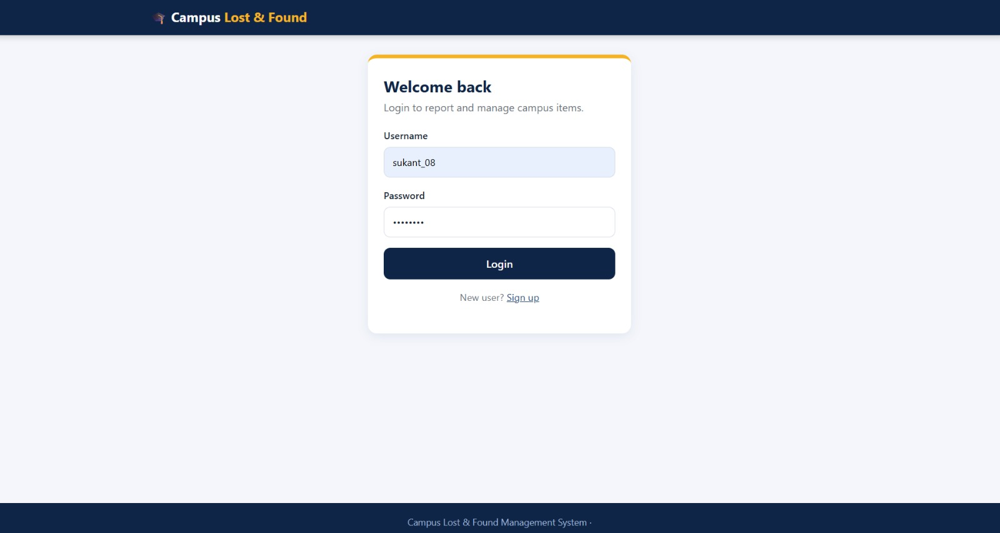
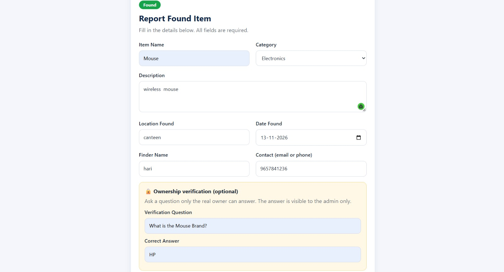
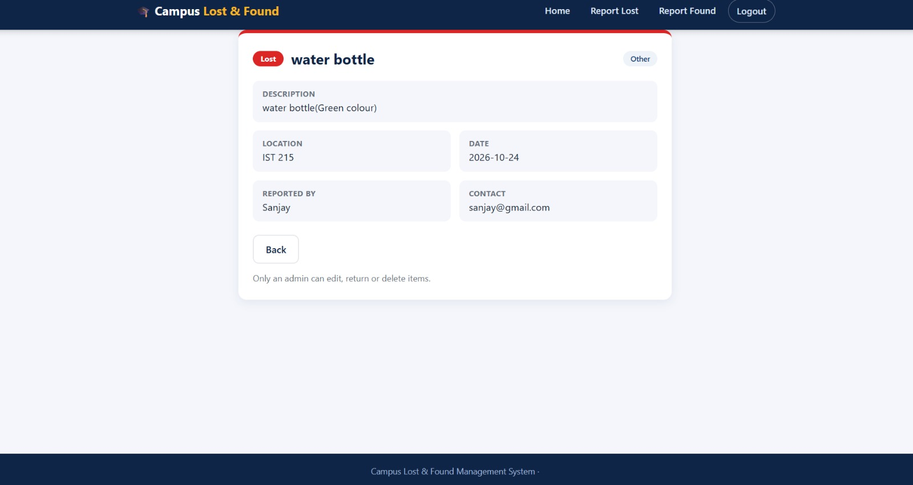
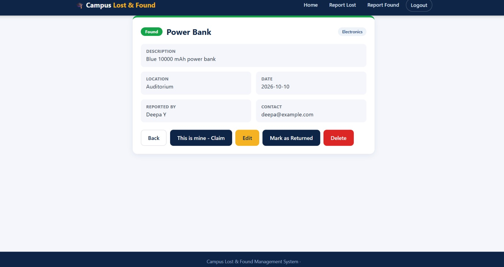

# Campus Lost & Found Management System

A web app where students and staff report lost and found items on campus, search them, and claim found items by answering a verification question. The admin approves or rejects claims and closes cases as Returned.

## Features
- Signup, login and logout (hashed passwords, sessions)
- Report Lost and Report Found forms with validation
- Home page with Total / Lost / Found / Returned counts
- Search by item name, category and location
- Filter by Lost, Found and Returned, with pagination
- View Details page for every item
- Ownership verification: the finder sets a question, the claimant answers, the admin approves or rejects
- Admin controls: edit, mark as Returned, delete, review claims
- Responsive design with plain HTML and CSS (no JavaScript)

## Tech Stack
Python, Flask, MySQL 8.0, mysql-connector-python, HTML, CSS, Jinja2

## Setup
1. Install Python and MySQL Server.
2. Open the project folder in VS Code and run:
   ```
   python -m venv venv
   venv\Scripts\activate
   pip install -r requirement.txt
   ```
3. Create the database and tables: run `schema.sql` in MySQL Workbench.
4. (Optional) Add sample records: run `sample_data.sql` once.
5. Copy `.env.example` to `.env` and fill in:
   - `DB_PASSWORD`: your MySQL root password
   - `SECRET_KEY`: any long random text
   - `ADMIN_USERNAME`: the username that will be the admin
6. Start the app:
   ```
   python app.py
   ```
7. Open http://127.0.0.1:5000, sign up, and log in.

To become the admin, sign up with the same username as `ADMIN_USERNAME`, then log out and log in again.

## Project Structure
```
app.py            routes and validation
db.py             database connection and helpers
templates/        HTML pages (Jinja2)
static/           CSS
schema.sql        database and table scripts
sample_data.sql   sample records
```

## Database Tables
- `items`: all lost and found reports
- `users`: login accounts (password hashes only)
- `verifications`: question and answer set by the finder
- `claims`: claim requests and their status

## Security
Hashed passwords, parameterized SQL queries, signed sessions, login required on every page, admin-only routes, server-side validation, secrets kept in `.env`.

## Screenshots






## Future Enhancements
- Image upload for items
- Email or SMS alerts
- AI-based matching of lost and found items
- College email verification
- Admin analytics